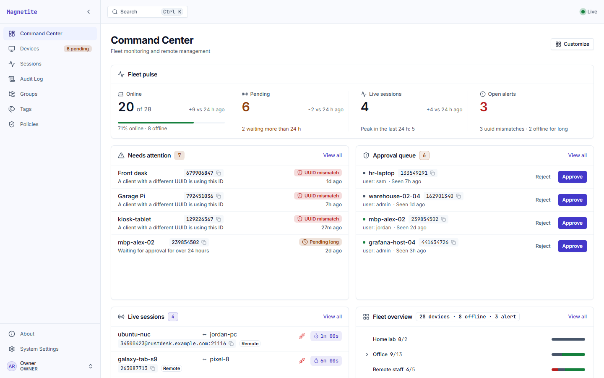
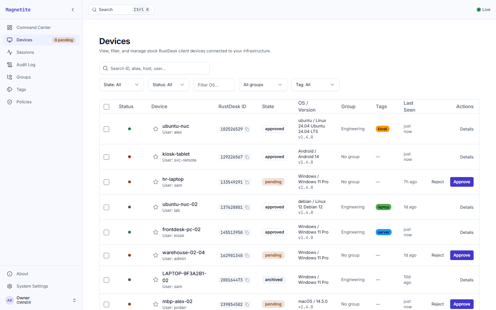

# Ferricade

*A self-hosted admin console for RustDesk.*

You run your own RustDesk server and want to see and approve its devices, connect
in one click, and know who did what. Ferricade gives you that next to unmodified
`hbbs` and `hbbr` servers, using stock RustDesk clients. Ferricade is not
affiliated with the RustDesk project or Purslane Ltd.



## What you get

**Devices**

- See which devices are online right now.
- Review new devices before they appear in your managed fleet.
- Open a RustDesk connect link for an approved device.

**Access and security**

- Give each user access only to assigned devices and groups.
- Sign in with a password and TOTP, or connect an OpenID Connect provider.
- Open an access window when a device needs temporary access.

**Fleet control**

- Keep client settings consistent with named policies.
- Group devices by hostname rules and resolve matching conflicts.
- Apply ID allow lists to limit which RustDesk IDs clients accept.
- Prepare Windows and Linux scripts to configure RustDesk clients.

**Records**

- See remote sessions and fleet activity in the dashboard.
- Keep an append-only record of administrative changes.
- Export audit events and session activity to a file or syslog.

## How it fits

RustDesk clients connect to `hbbs` and `hbbr` for rendezvous and relay traffic.
They also send device heartbeats and system information to Ferricade's client
API on port 21114. You use the admin console over HTTPS; it talks to Ferricade's
admin API on port 21120 behind your HTTPS reverse proxy.

## Quick start

Download `deploy/compose.yml` and `deploy/.env.example` from the same release
into a `deploy/` directory, or clone this repository. The Compose file runs
Ferricade with PostgreSQL 16. The image supports `linux/amd64` and `linux/arm64`.

Copy the example file, generate the two secrets, set the release version and
public HTTPS URL, then start the services:

```sh
cp deploy/.env.example deploy/.env
# Set FERRICADE_VERSION, SECRET_KEY, PUBLIC_URL, and POSTGRES_PASSWORD.
# Generate SECRET_KEY with openssl rand -base64 32.
# Generate POSTGRES_PASSWORD with openssl rand -base64 24.
docker compose --env-file deploy/.env -f deploy/compose.yml up -d
docker compose --env-file deploy/.env -f deploy/compose.yml logs app | grep 'setup token'
```

### First run

1. Open `<PUBLIC_URL>/first-run` and enter the setup token from the app log.
2. Create the owner account and enroll an authenticator for TOTP.
3. Enter the RustDesk ID host, relay host, and public server key.
4. Finish setup and copy the client configuration shown by Ferricade.
5. Import the configuration in RustDesk or use the generated install command.
6. Wait for a device to report in, then approve it in the console.
7. Open the approved device and use its connect link.

Approval controls what Ferricade lists and which devices get connect links. It
does not stop an unapproved client from using the RustDesk server.

## Ports

| Port | Service | Use |
|---|---|---|
| 21114/tcp | Ferricade client API | RustDesk heartbeats and system information; plain HTTP |
| 21115/tcp | `hbbs` | NAT test and online status query |
| 21116/tcp and udp | `hbbs` | ID and rendezvous traffic |
| 21117/tcp | `hbbr` | Relay traffic |
| 21120/tcp | Ferricade admin API | Admin console and setup behind HTTPS |

Clients need the client API and RustDesk server ports. People use the console
at the HTTPS URL set in `PUBLIC_URL`. Port 21120 is an internal HTTP listener
and does not need to be public. RustDesk clients derive the API address on
21114, which stays plain HTTP.

To run `hbbs` and `hbbr` in the same Compose project, download
`deploy/compose.rustdesk.yml`, set `RELAY_HOST` to the address clients use for
the relay, and set `HBBS_ADDR=hbbs:21115`. Start both files together:

```sh
docker compose --env-file deploy/.env -f deploy/compose.yml -f deploy/compose.rustdesk.yml up -d
```

The included servers use key authentication. Their public key is created in
the persistent `rustdesk-data` volume. Enter it during first-run setup and
configure it on each RustDesk client. If you already run `hbbs` and `hbbr`,
keep the first Compose command and set `HBBS_ADDR` to your `hbbs` host.

## Keep your secrets

Keep `SECRET_KEY` and `POSTGRES_PASSWORD` safe. Replacing `SECRET_KEY` makes
stored TOTP and single sign-on secrets unreadable. Changing
`POSTGRES_PASSWORD` after the database volume is created does not change the
password stored in that volume.

## Built with AI

Ferricade was built largely by AI coding agents (Claude, Codex, and Gemini),
directed and reviewed by one person. Changes are checked with tests and CI
gates. It was built to scratch a real itch and is shared in case it helps
someone else. Issues and pull requests are welcome.

## Status and compatibility

Ferricade is stable at version 2.0.0. It has been tested with stock RustDesk
1.5.0 clients. The admin console serves the web UI from the same origin as its
API.

## Read more

- [Deployment and administration guide](docs/guide.md)
- [Changelog](CHANGELOG.md)


## License

MIT, see [LICENSE](LICENSE).
