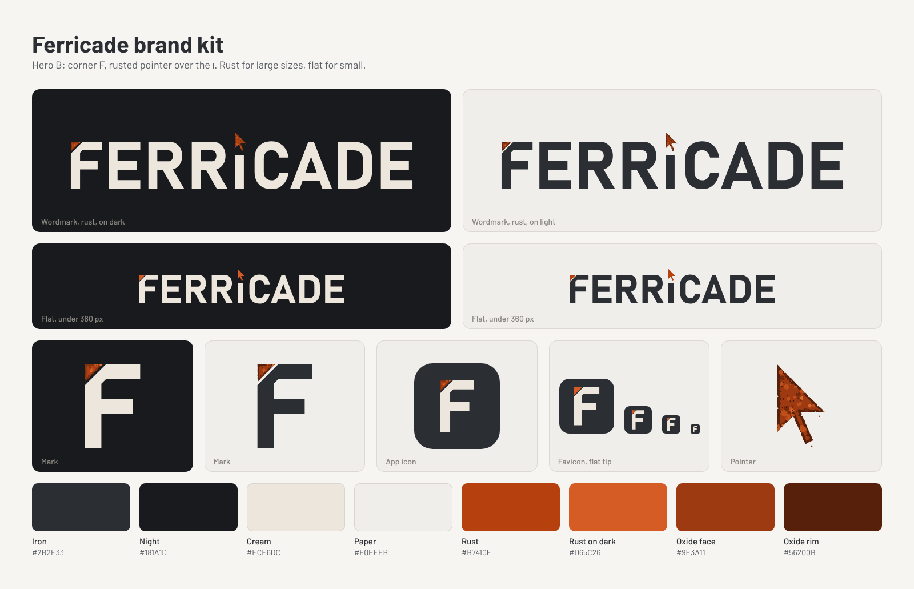

# Ferricade brand kit



The Ferricade identity is a play on *ferrous oxide* and *barricade*, drawn for what the app is: a remote-desktop console. The logo is **Hero B**: a corner-cut F whose clipped corner reads as a cursor tip, the name set in caps with a dotless **ı**, and a rusted mouse pointer hovering where the dot would be.

This folder is self-contained. Nothing in `web/` uses it yet; see [Using it in the app](#using-it-in-the-app).

## What's here

| Folder | Contents |
|---|---|
| `logo/` | Wordmark and mark as SVG, in **rust** and **flat** styles, each `on-dark` and `on-light`; the rusted pointer on its own |
| `logo/png/` | PNG renders of the wordmarks (1280 and 2560 px wide) and marks (512 px tall), transparent |
| `app-icons/` | App icon, maskable icon, Apple touch icon, favicon (SVG, PNG 16/32/48, ICO), named to match `web/public/icons` |
| `motion/` | `ferricade-loader.svg` (looping), `ferricade-intro.svg` (first run, pointer B), an alternate intro with the two-tone pointer, and `preview.html` to watch them |
| `social/` | GitHub social preview (1280×640) and Open Graph image (1200×630) |
| `tokens/` | Colours, type and motion timings as `tokens.css` and `tokens.json` |
| `source/` | The scripts that draw everything, plus the letter outlines and the Barlow web font |

## Logo

**Rust or flat.** The rust style (corroded rim, pitting, mottled oxide on the F's corner and the pointer) is for large, hero uses: login screen, about page, README banner, social cards. Below about **360 px wide** the texture turns to noise, so use the flat style: navigation bar, emails, documents, anything small.

**On dark or on light.** `on-dark` files have cream letters and a brighter rust; `on-light` files have iron letters and the deeper rust. Pick by the ground, not by preference.

**Clear space.** Keep at least half the cap height (the height of the F) clear on every side. The pointer is part of the logo's outline: measure from its tip, not from the letters.

**Minimum sizes.** Rust wordmark 360 px wide; flat wordmark 120 px wide; mark 24 px tall; below that, use the favicon.

**Don't**
- retype the wordmark in a font; it is drawn outlines (Bahnschrift Bold, adjusted)
- move, recolour or drop the pointer, or put a dot on the ı
- recolour the rust to a UI theme accent; rust is the brand's one accent
- stretch, outline, add shadows, or animate the rust texture itself
- put the rust style on busy photos; use the flat style on a plain Night or Paper panel

## Mark and app icon

The mark is the corner F alone, with its rusted tip. On the app icon it is cream on an iron rounded square.

| Size | Use |
|---|---|
| 96 px and up | `icon.svg`, `icon-512.png`, `icon-192.png` (rust tip) |
| 64 px and down | `favicon.svg`, `favicon.ico`, `favicon-16/32/48.png` (flat rust tip, bigger F) |
| PWA maskable | `icon-maskable.svg`, `icon-maskable-512.png` (full bleed, F inside the safe zone) |
| iOS home screen | `apple-touch-icon.png` (180 px, full bleed; iOS rounds the corners) |

## Colour

| Name | Hex | Role |
|---|---|---|
| Iron | `#2B2E33` | Logo ink on light grounds; app icon plate |
| Night | `#181A1D` | Dark ground |
| Cream | `#ECE6DC` | Logo ink on dark grounds |
| Paper | `#F0EEEB` | Light ground |
| Rust | `#B7410E` | The accent, on light grounds |
| Rust on dark | `#D65C26` | The accent, on dark grounds |
| Oxide face / rim | `#9E3A11` / `#56200B` | Texture only (full set, both grounds, in `tokens/`) |

Rust is the only accent. It marks the F's corner and the pointer, never large fills or text.

## Type

The wordmark is outlines, so it renders the same everywhere. For brand display text (titles on the social card, a splash screen line), use **Bahnschrift** with **Barlow** as the web fallback (`--fc-font-display`); Barlow ships in `source/fonts/` under the SIL Open Font License. The app's interface type stays Inter, as `DESIGN.md` sets it.

## Motion

Both pieces are single SVG files with their own CSS animation; inline them or use them as ``. Colours follow the system light or dark setting; on an inline SVG, add `night` or `paper` to its `class` to pin a ground. Open `motion/preview.html` to watch them on both grounds.

**Loader** (`ferricade-loader.svg`): a 3.6 s loop. Three outlines of the F, soft and rounded far out, sharpen as they pull in; one lands every 1.2 s and the rust tip warms as it arrives. Reads best from about 96 px.

**Intro** (`ferricade-intro.svg`): plays once, about 4.85 s, for first launch.

| Time | Beat |
|---|---|
| 0.00 s | Three rings pull in toward the centre |
| 0.55 s | The F condenses as they land |
| 1.35 s | The rusted tip snaps into its corner |
| 2.00 s | The F glides left to its place in the wordmark |
| 2.62 s | The letters are drawn in toward it, one by one |
| 3.30 s | The pointer drifts in over the ı |
| 4.05 s | Click: the pointer presses and flashes, the ı dips, a ripple rings out |
| 4.85 s | Settled |

CSS animations restart when the node is replaced, so a replay is `el.replaceWith(el = el.cloneNode(true));`.

**Reduced motion.** With `prefers-reduced-motion: reduce`, the rings and ripple are dropped, the loader keeps only a slow warm pulse on the tip, and the intro fades in at its final layout.

## Using it in the app

Not done in this change, so the app keeps working as it is. When you're ready:

1. Copy `app-icons/icon.svg`, `icon-192.png`, `icon-512.png`, `icon-maskable.svg`, `icon-maskable-512.png` and `apple-touch-icon.png` over the files of the same name in `web/public/icons/`, and point the favicon in `web/index.html` at `favicon.svg`. The current per-theme icons (`icon-graphite.svg` and others) would need a decision: keep them, or retire them for the brand icon.
2. In `web/public/manifest.json` and `web/index.html`, `theme_color` is the indigo of the Default theme (`#4338ca`); Night (`#181A1D`) would match the icon.
3. Use the loader where the shell waits on the first API call, and the intro on first sign-in. Deciding "first time" needs a stored flag; check `openapi.yaml` before adding one.
4. Set `social/ferricade-social-1280x640.png` as the repository's social preview (GitHub, Settings, General, Social preview).

## Rebuilding

Everything is generated from `source/`, so a change to the drawing goes through the scripts:

```sh
python3 brand/source/motion.py   # motion/*.svg and motion/preview.html
python3 brand/source/kit.py      # logo/, app-icons/*.svg, tokens/
python3 brand/source/render.py   # PNG, ICO, social images, preview.png
```

`render.py` needs Pillow and Playwright (`pip install pillow playwright`, then `playwright install chromium`, or set `CHROME` to an installed Chrome). The rust texture is procedural with fixed seeds, so rebuilding gives the same pattern.

`source/glyphs.json` holds the letter outlines, exported from Bahnschrift Bold at 248 pt in Affinity. The Affinity working file, with every exploration round, is not in the repository.
